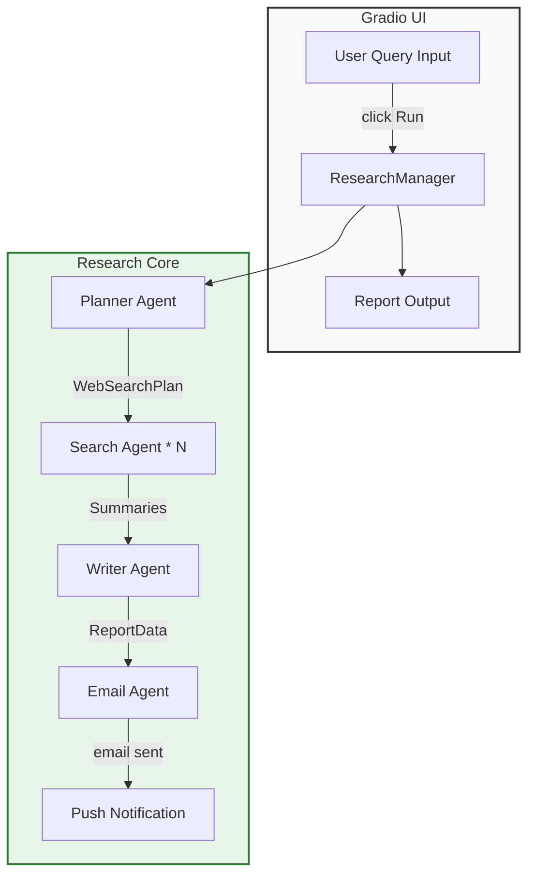

# Deep Research Framework 🚀

**Automated, multi‑agent research pipeline** that turns a natural‑language question into a polished research report and delivers it by e‑mail.  The system is built on the **OpenAI Agents** library and runs entirely async, making it suitable for both interactive UI use and headless automation.

---

## Table of Contents
1. [Why This Exists](#why-this-exists)
2. [Core Concepts & Agents](#core-concepts--agents)
3. [Architecture Diagram](#architecture-diagram)
4. [Quick Start (CLI / UI)](#quick-start)
5. [Configuration](#configuration)
6. [Programmatic API](#programmatic-api)
7. [Extending the Pipeline](#extending-the-pipeline)
8. [Testing & CI](#testing--ci)
9. [Contributing](#contributing)
10. [License](#license)

---

## Why This Exists
Research teams and product managers often spend **hours** manually googling, collecting snippets, and drafting reports.  This repo demonstrates how to **orchestrate several LLM‑driven agents** to automate that workflow:
- **Planner** decides which web searches are needed.
- **Searcher** pulls concise, citation‑rich summaries.
- **Writer** synthesises a 5‑10 page markdown report.
- **Emailer** formats the report as a professional HTML e‑mail.

The result is a repeatable, auditable pipeline that can be embedded in notebooks, CI jobs, or a simple Gradio UI.

---

## Core Concepts & Agents
| Agent | Responsibility | Key Input / Output |
|-------|----------------|--------------------|
| **Planner Agent** | Generates `HOW_MANY_SEARCHES` (default 5) search terms based on the user query. | Returns a `WebSearchPlan` Pydantic model – a list of `WebSearchItem`s (query + rationale). |
| **Search Agent** | Executes each search using `WebSearchTool` and returns a 2‑3 paragraph summary (< 300 words). | Input: `(query, rationale)` string. Output: plain‑text summary. |
| **Writer Agent** | Consumes the original query and all summaries to produce a detailed markdown report (≈ 1000 words, 5‑10 pages). | Returns a `ReportData` model (`short_summary`, `markdown_report`, `follow_up_questions`). |
| **Email Agent** | Takes the markdown report, crafts a subject line, converts to HTML and sends via SMTP (or pushes to Pushover when disabled). | No return value – just logs success. |

All agents share the same **model configuration** (default `gpt-5.4-mini`) and are invoked through `agents.Runner.run` for deterministic async execution.

---

## Architecture Diagram

*The diagram shows the data flow from the UI through each agent to the final e‑mail.*

---

## Quick Start (CLI / UI)
```bash
# 1️⃣ Install dependencies
pip install -r deep_research/requirements.txt

# 2️⃣ Create a .env file (see Configuration below)
cp .env.example .env

# 3️⃣ Launch the interactive UI
python -m deep_research.app
```
A browser window opens at `http://127.0.0.1:7860`.  Type a research question, hit **Investigate**, and watch live status updates.

For head‑less execution:
```python
import asyncio
from deep_research.research_manager import ResearchManager

async def main():
    async for update in ResearchManager().run("Most popular AI Agent frameworks in 2026"):
        print(update)

asyncio.run(main())
```

---

## Configuration
All runtime options are read from environment variables (via `python‑dotenv`).  Example `.env`:
```dotenv
# Model selection – any model supported by openai‑agents
DEFAULT_MODEL_NAME=gpt-5.4-mini

# How many searches the planner should create
HOW_MANY_SEARCHES=5

# Email handling – set to false for local testing only
USE_EMAIL=true
EMAIL_ADDRESS=you@domain.com
EMAIL_SMTP_SERVER=smtp.gmail.com
EMAIL_APP_PASSWORD=your_app_password

# Optional push notification via Pushover (works when USE_EMAIL=false)
PUSHOVER_USER=xxxxxxxxx
PUSHOVER_TOKEN=yyyyyyyyy
```
The `messenger.py` module abstracts email and push logic.  When `USE_EMAIL` is false, the report is printed to the console and a Pushover message is sent.

---

## Programmatic API
The library exposes a single entry point – `ResearchManager.run(query: str)`.  It yields a stream of status strings and finally the markdown report.
```python
from deep_research.research_manager import ResearchManager
import asyncio

async def demo():
    async for status in ResearchManager().run("Future of quantum‑ready AI agents"):
        print(status)

asyncio.run(demo())
```
You can also import individual agents if you need fine‑grained control:
```python
from deep_research.planner_agent import planner_agent
from deep_research.search_agent import search_agent
from agents import Runner

plan = await Runner.run(planner_agent, "Query: …")
```

---

## Extending the Pipeline
| Goal | How to achieve |
|------|----------------|
| **Change the web‑search backend** | Replace `WebSearchTool()` in `search_agent.py` with a custom tool (e.g., SerpAPI, Bing, or a local vector store). |
| **Add post‑processing** | Insert a new async method in `ResearchManager` after `write_report` and before `send_email`; invoke a new agent for analytics or summarisation. |
| **Support other output formats** | Add another agent that transforms `ReportData.markdown_report` into PDF (using `WeasyPrint`) or slides (reveal.js). |
| **Parallelise searches across clusters** | Swap the simple `asyncio.gather` in `perform_searches` with a Ray or Dask remote executor. |

All extensions should remain **pure async** to keep the UI responsive.

---

## Testing & CI
A minimal test suite lives in `tests/` (not yet committed).  The recommended CI pipeline:
1. **Run lint** – `ruff check . && ruff format --check .`
2. **Run type‑checking** – `mypy .`
3. **Execute unit tests** – `pytest -q`
4. **Smoke‑test the UI** – launch `python -m deep_research.app` in a headless environment and hit the endpoint.

---

## Contributing
We welcome contributions!  Please follow these steps:
1. Fork the repo and create a feature branch.
2. Ensure your code passes the lint / type checks.
3. Add or update documentation (README, docstrings).
4. Submit a Pull Request with a clear description of the change.

---

## License
MIT – free to use, modify, and redistribute. See `LICENSE` for details.
